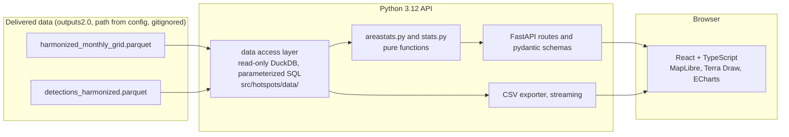
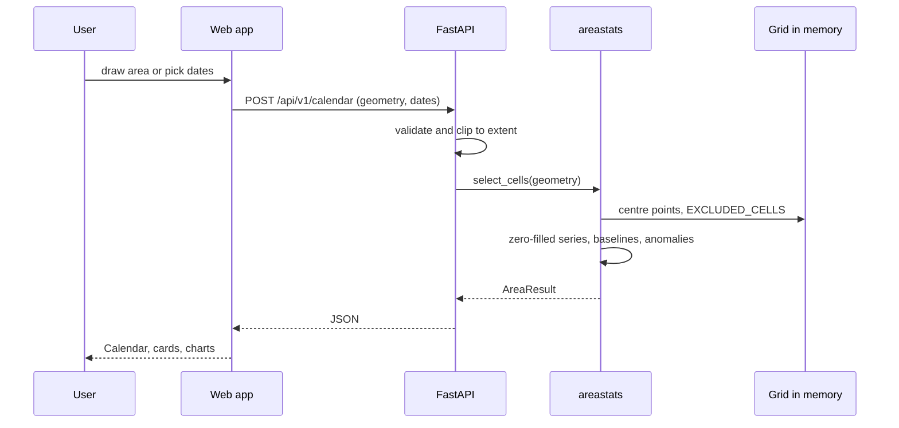
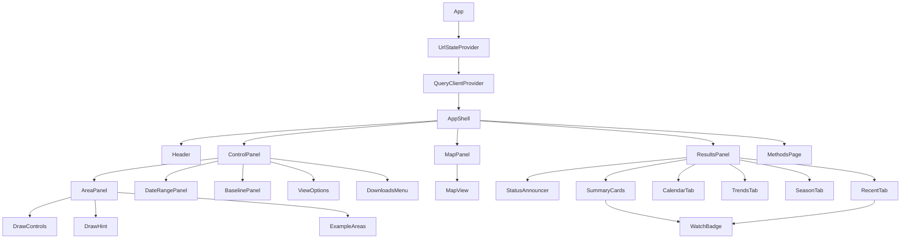

# Design Document: Harmonized Fire Calendar

## Overview

The Harmonized Fire Calendar is a web application for the "California region" (NASA Space Apps 2026, MODIS and VIIRS Hot Spots). It shows one consistent record of burning activity from November 2000 to the present as a month x year Calendar, with baselines, anomalies, a season tracker, a recent-activity view and CSV downloads.

The data pipeline (acquisition, filtering, calibration, harmonization, validation) was built outside this project. This app only reads its delivered Parquet files (`.kiro/steering/data-contract.md`, with method and validation numbers in `outputs2.0/DATA_README.md`). It never re-derives them.

Key facts that shape the design:

| Topic | Design consequence |
|---|---|
| Counting unit is the cell-day (one 0.1 degree display cell with at least one kept detection on a local day, once per sensor family) | Every count in the UI and API is labelled "cell-days (MODIS-equivalent)". CSV rows are raw detections and do not reconcile row for row. |
| `harmonized_monthly_grid.parquet` is sparse (89,467 rows, 5,370 cells). A missing row means zero. | Area series are built by a LEFT JOIN onto the list of in-record complete months with zero fill. |
| Monthly grid only. No daily harmonized counts, no uncertainty file, no static-mask file. | Daily harmonized chart, season timing, 7-day Watch_Level, filter map and filter counts are deferred. Intervals are null fields. |
| Fixed UTC-8 local day (PST, no daylight saving). `acq_datetime_utc` is true UTC. | Stated in the UI, CSV headers and methods page. |
| Climatology and anomaly Parquet files are not used. | Baselines and anomalies are computed at query time from the zero-filled series. |

Region label: "California region". The UI never says "California state" and makes no claim about a state boundary mask (unknown). Measured extent: lat 32.5 to 42.2, lon -124.4 to -114.0 (EPSG:4326). DEFAULT (confirm)

### Design decisions

1. **Compute at query time from an in-memory grid.** The grid is 89,467 rows. It is loaded once through DuckDB into NumPy arrays. A cells x months matrix makes any area query a masked column sum. Detections (2,105,593 rows) stay on disk and are queried with Parquet pushdown. Rationale: simple, fast (well under 1 s), no precompute step to keep in sync.
2. **Pure statistics module.** `areastats.py` and `stats.py` have no I/O, so they can be property-tested with Hypothesis.
3. **One container.** FastAPI serves the built React app. The data files reach the host separately (decision 6).
4. **URL is the source of truth for app state** (area, dates, baseline, view), so every view is shareable.
5. **Monthly granularity.** Statistics use whole months. Exact dates apply only to the Recent_View and hotspot CSV.
6. **Data delivery to the host (open).** Files are never in git. Recommended: a private or public Hugging Face dataset repo holding the two needed Parquet files, downloaded at container start into the config data path (`huggingface_hub`, token in a Space secret). Alternative: bake the files into a locally built image. DEFAULT (confirm)

### Open decisions and gaps

| # | Item | Default used |
|---|---|---|
| G1 | Extent: measured lat 32.5 to 42.2, lon -124.4 to -114.0 versus addendum 42.3 and -113.9 | Measured values. DEFAULT (confirm) |
| G2 | State boundary mask applied or not | Unknown. No claim either way. DEFAULT (confirm) |
| G3 | Recent_View window | 7 local days ending on the latest local date in `detections_harmonized.parquet`. DEFAULT (confirm) |
| G4 | Raw daily bars | Bars count raw detections, labelled "raw, not harmonized". DEFAULT (confirm) |
| G5 | Month granularity for Watch_Level, season tracker, briefing | Months only. DEFAULT (confirm) |
| G6 | Data delivery to the host | HF dataset repo downloaded at start. DEFAULT (confirm) |
| G7 | Calibration holdout-error file (`reports/phase2d_*.csv`) not delivered | Bounds stay null. Req 7.3 blocked until the owner supplies it. |
| G8 | No daily harmonized data | Req 16.6, 20.7, 22, 24.3 to 24.5 deferred. |
| G9 | Provisional month = grid `incomplete` flag (no standard versus NRT flag in the grid) | DEFAULT (confirm) |
| G10 | Boundary rule for cell centres exactly on polygon edges | Perturbation rule in section 3.1. DEFAULT (confirm) |
| G11 | Draw hint scope | Browser tab session (`sessionStorage`). DEFAULT (confirm) |
| G12 | Bundle budget 700 KB gzip initial JS | DEFAULT (confirm) |
| G13 | Updating state starts after 300 ms | DEFAULT (confirm) |

## Architecture



### Request flow for an area query



### Layers and rules

- `src/hotspots/data/`: the only code that opens Parquet. Read-only DuckDB connection, parameterized SQL, DuckDB version pinned (2.0.0 per DATA_README). Join on `cell_id`, never on `disp_lat` or `disp_lon`.
- `src/hotspots/areastats.py`: cell selection, zero-filled series, baselines, anomalies. No I/O.
- `src/hotspots/stats.py`: Watch_Level, season tracker, rankings. No I/O.
- `src/hotspots/api/`: routes, schemas, error handlers.
- `web/`: front end. Reads only the API.
- No acquisition, parsing, calibration or harmonization code anywhere.

## Components and Interfaces

### 1. App configuration (`hotspots.config`)

```yaml
region:
  name: "California region"
  extent: {west: -124.4, south: 32.5, east: -114.0, north: 42.2}   # measured, DEFAULT (confirm)
data_dir: outputs2.0
record_start: "2000-11"
excluded_cells: ["38.7000_-117.4000"]
baseline: {start: "record_start", exclude_incomplete: true}
watch_threshold: 90
csv_avg_bytes_per_row: 0      # measured once on detections_harmonized.parquet, DEFAULT (confirm)
example_areas:                 # 3 to 5 entries, GeoJSON Polygon, EPSG:4326
  - {name: "Central Valley farmland", description: "...", geometry: {type: Polygon, coordinates: [...]}}
```

`load_config(path) -> AppConfig | ConfigErrors` validates every field and returns all errors at once (Req 1.2, 1.10). It checks that both Parquet files exist in `data_dir`, that `record_start` is `YYYY-MM`, that excluded cells are non-blank strings, that the extent is ordered and in range, that `0 < watch_threshold < 100`, and the example-area rules (3 to 5 entries, name 1 to 60 characters, description at most 160, closed non-self-intersecting ring with at least 4 positions, positive area, inside the extent with boundary counting as inside). On errors the API prints all of them and exits non-zero. No data path is hard-coded.

### 2. Acquirer - completed externally

Not implemented. The delivered files are the data source. The methods page cites DATA_README for acquisition (Req 2).

### 3. Parsers - completed externally

Not implemented. The detections schema is read as delivered (Req 3). CSV export uses the delivered column names.

### 4. Filter and mask - completed externally

Not implemented. Filters already applied (low confidence dropped, type 0 only, 211-cell static mask for near-real-time rows) are described as text on the methods page and in CSV headers (Req 4, 5). They are never reapplied.

### 5. Harmonizer - completed externally

Not implemented. `count_harmonized` is used as delivered. The UI shows `source_flag`, `calib_model` and `provenance` per month (Req 6). Optional `lower_bound` and `upper_bound` fields are always null for now (Req 7).

### 6. Validator - completed externally

Not implemented. The methods page restates the numbers in DATA_README: statewide holdout RMSE 22.2, bias 0.8, seasonality correlation 0.989; 2009 to 2011 mean 383.7 against 2012 to 2014 mean 366.3 (-4.5 %); metrics for 96 of 98 regions; best model picked on the same holdout used for reporting, so accuracy is slightly optimistic (Req 8).

### 7. Data access layer (`hotspots.data`)

```python
class DataStore:
    def __init__(self, cfg: AppConfig) -> None: ...        # opens read-only DuckDB, loads grid
    def grid(self) -> GridArrays: ...                       # in-memory, cached
    def latest_month(self) -> YearMonth: ...                # latest month in grid (may be incomplete)
    def latest_complete_month(self) -> YearMonth: ...
    def detections_latest_local_date(self) -> date: ...
    def detections_latest_utc(self) -> datetime: ...
    def count_detections(self, bbox: BBox, d0: date, d1: date) -> Iterator[DetectionBatch]: ...
    def iter_detections(self, bbox: BBox, d0: date, d1: date, batch: int = 50_000) -> Iterator[pa.Table]: ...
```

`GridArrays`: `cell_ids: list[str]`, `centre_lat`, `centre_lon` (float64, rounded to 6 decimals from `disp_* + 0.05`), `month_index` (int32, months since 2000-01), and a dense `float64` matrix `harm[cell, month]`, plus `raw_modis`, `raw_viirs` (int32) and `frp_sum` (float64) built from the sparse rows (missing = 0). It also keeps per-month `incomplete`, `source_flag`, `calib_model` majority and `provenance` union, taken from the rows of that month. The dense matrix is 5,370 x about 313 months, about 13 MB per float64 array.

Rules:
- All SQL uses bound parameters (`?`). No string interpolation of user input.
- Rows for `EXCLUDED_CELLS` are dropped at load time. Months before `RECORD_START` are dropped from the series (October 2000 never enters a calendar or baseline).
- `frp_mean` is never averaged. `frp_sum` is summed for area totals. The API returns FRP sum or null (never a mean across cells).
- Detections: query with `WHERE acq_date_local BETWEEN ? AND ? AND lat BETWEEN ? AND ? AND lon BETWEEN ? AND ?` (Parquet row-group pushdown), then point-in-polygon in Python on each batch (vectorised `shapely.contains_xy` on a prepared geometry).

### 8. Area statistics (`hotspots.areastats`, pure)

#### 8.1 Cell selection and boundary rule

`select_cells(centres_lat, centres_lon, polygon) -> np.ndarray[bool]` selects a cell when its centre point (`disp_lat + 0.05`, `disp_lon + 0.05`, rounded to 6 decimals) lies inside the polygon. The rule is deterministic and half-open:

1. A centre strictly inside the polygon is selected. A centre strictly outside is not.
2. A centre exactly on an edge or vertex is decided by testing the perturbed point `(lon + 1e-9, lat + 1e-12)` strictly inside the polygon (a fixed infinitesimal shift toward north-east, "simulation of simplicity"). Perturbation is applied only when the unperturbed point is on the boundary.

Consequence: for two non-overlapping parts that share an edge, a centre on that edge is selected in at most one part (the part lying to the north-east of the edge), and the union of the parts selects exactly what the whole area selects (partition property, Property 21). For an axis-aligned rectangle the rule is equivalent to `[west, east) x [south, north)`.

Cells are selected on a prepared shapely geometry (`shapely.prepared.prep`) using `shapely.contains_xy` over the centre arrays, then excluded cells are removed. The selection mask is cached in an LRU (size 64) keyed by the SHA-256 of the canonical geometry (coordinates rounded to 6 decimals).

#### 8.2 Zero-filled series

```python
def zero_filled_series(
    harm: np.ndarray, mask: np.ndarray, months: list[YearMonth],
    complete: np.ndarray, record_start: YearMonth,
) -> np.ndarray: ...
```

The month list is every year-month on or after `record_start` up to the latest month in the grid whose `incomplete` flag is false. Area sums come from `harm[mask].sum(axis=0)`; a month with no row in the area is 0.0. The provisional month is returned separately and never enters this series. Raw MODIS and raw VIIRS cell-days are summed the same way and stay two separate series (never added).

#### 8.3 Baselines

For each calendar month 1 to 12, over the baseline period (default: full record from `RECORD_START`, incomplete months excluded), from the zero-filled series:

`Baseline(median, p10, p90, mean, std, n_years)`, with percentiles by linear interpolation (NumPy `method="linear"`), `std` the sample standard deviation (`ddof=1`, null when `n_years < 2`), and `n_years` the number of years in the series for that calendar month. A year-level baseline (sums per calendar year, complete years only) is computed the same way for yearly anomalies.

An optional user baseline of 5 to 30 complete in-record years (P1) is validated by `validate_baseline_years` and rejected with a message naming the limit.

#### 8.4 Anomalies

```python
@dataclass(frozen=True)
class Anomaly:
    absolute: float                 # x - median
    percent: float | None           # 100 * (x - median) / median; None if median == 0
    percent_text: str | None        # "no typical fires in this month" when median == 0
    zscore: float | None            # (x - mean) / std; None if std == 0 or undefined
    percentile_rank: float          # 100 * (L + 0.5 * E) / N, mid-rank, 0..100
    baseline_start_year: int
    baseline_end_year: int
    n_years: int
```

The provisional month and a year containing it get `provisional=True` and null anomaly fields (not evaluated). Infinity and NaN are never produced.

#### 8.5 Result type

```python
@dataclass(frozen=True)
class MonthRow:
    year: int; month: int
    harmonized: float                      # cell-days, MODIS-equivalent, unrounded in core
    raw_modis: int; raw_viirs: int         # cell-days, never summed
    frp_sum_mw: float | None
    source_flag: str | None; calib_model: str | None; provenance: str | None
    provisional: bool
    lower_bound: float | None = None       # deferred (Req 7)
    upper_bound: float | None = None
    anomaly: Anomaly | None = None
```

Rounding to one decimal for harmonized values and integers for raw counts happens only in the API serializer.

### 9. Statistics (`hotspots.stats`, pure)

- **Watch_Level** (Req 20.8 to 20.16): for the Latest_Complete_Month only. Percentile rank (mid-rank) against the zero-filled baseline years for that calendar month. "Not available" (with a reason) when fewer than 5 baseline years exist for that calendar month or the series is empty. Otherwise "Above normal" when rank is greater than `watch_threshold` (default 90), else "Within normal range". The incomplete latest month is returned beside it as provisional with its count to date and is not evaluated. The 7-day Watch_Level is DEFERRED (no daily harmonized series).
- **Season tracker** (Req 21): monthly. For each Season_Year (start month configurable, default January), cumulative sums at month-of-season 1 to 12 from the zero-filled series. Envelope (p10, median, p90) over season years that lie entirely inside the baseline period; fewer than 5 such years gives no envelope. The in-progress season stops at the Latest_Complete_Month. Percent of median is null when the median is 0. Season timing metrics (onset, peak, end) are DEFERRED.
- **Rankings** (Req 16.5): top 10 months and top 10 years by harmonized count, descending, ties by earlier date first, provisional month and its year excluded.
- **Briefing inputs** (Req 23): rank and percentile of the Latest_Complete_Month among the same calendar months, year-to-date versus median cumulative, months with the highest baseline median. Monthly only, no day-level statement.

### 10. API (`hotspots.api`)

All routes are under `/api/v1` except `/api/health`. Bodies are pydantic v2 models with `extra="forbid"`. Geometry bodies are capped at 6 MB and 1000 vertices. Errors use one envelope:

```json
{"error": {"code": "invalid_geometry", "message": "Polygon self-intersects.", "fields": [{"field": "geometry", "reason": "self_intersection"}], "request_id": "..."}}
```

Validation failures return HTTP 422. Unexpected errors return HTTP 500 with code `internal_error` and a request id. Stack traces are logged, never returned.

| Method and path | Purpose | Notes |
|---|---|---|
| `GET /api/health` | Liveness | Returns `data_present` (both files found) and `latest_month`. HTTP 503 when data is missing. |
| `GET /api/v1/meta` | Region metadata | Name, extent, `record_start`, `first_date`, `latest_month`, `latest_month_incomplete`, `latest_complete_month`, `latest_detection_local_date`, `latest_detection_utc`, `time_convention`, `unit`, `watch_threshold`, `limitations` (list of strings), `example_areas` read from config, `bounds_available: false`. |
| `POST /api/v1/selection/normalize` | Validate and clip | Body `{geometry}` or `{bbox}` or `{circle}` or `{geojson}`. Returns clipped geometry, `clipped_percent`, `ignored_features`, `n_cells`, `notice`. 422 with a reason on invalid shapes. |
| `POST /api/v1/calendar` | Calendar data | Body `{geometry, start, end, baseline_years?}`. Returns `months[]` (MonthRow fields rounded), `years[]` (year totals and anomalies), `baseline_by_month[]`, `baseline_year`, `coverage`, `n_cells`, `notice` (no cells), `provisional_months`. |
| `POST /api/v1/stats` | Cards and charts | Summary totals, raw MODIS and raw VIIRS cell-days (separate), current month and year versus baseline, rankings, seasonal profile, `watch`, `briefing_inputs`. |
| `POST /api/v1/season` | Season tracker | Body adds `season_start_month`, `season_year`. |
| `POST /api/v1/recent` | Recent view | Last 7 local days ending on the latest local date in the detections file: per-day raw detection counts (7 bars, zeros included), points (capped at 5,000, with count of omitted), `latest_utc`, `data_age_days`, `watch` (monthly). Raw, not harmonized. |
| `POST /api/v1/watch` | Watch badge | Same `watch` object as in `/stats`, for callers that need only the badge. |
| `POST /api/v1/export/hotspots/estimate` | CSV estimate | Returns `rows`, `approx_bytes`, `over_limit` (rows > 2,000,000). Same filter as the export. |
| `POST /api/v1/export/hotspots` | Streaming CSV | `StreamingResponse`, `text/csv; charset=utf-8`. 422 when over the limit. |
| `POST /api/v1/export/analytics` | Analytics CSV | One row per month and per year in the range, with baseline and anomaly columns and a provisional flag. |
| `POST /api/v1/share` and `GET /api/v1/share/{id}` | Short link for long URLs (Req 19.6) | SQLite file at `HOTSPOTS_SHARE_DB`, ID up to 16 characters, 30-day retention. Optional; the front end falls back to simplification when unavailable. |

**Hotspot CSV (Req 17).** Selection: bbox pre-filter, then point-in-polygon on `(lon, lat)` with the boundary rule of section 8.1, and `acq_date_local` within the exact start and end dates (inclusive, UTC-8). Columns, exactly these 16 in order: `sensor_family, satellite, source, lat, lon, acq_datetime_utc, acq_date_local, year, month, daynight, confidence_class, confidence_raw, frp, type, pixel_size_m, version`. The response starts with `#` comment lines: query geometry; local date range and the line "local standard time, fixed UTC-8, no daylight saving; acq_datetime_utc is true UTC"; generation time (UTC); source (NASA FIRMS MODIS and VIIRS active-fire detections, delivered data); filters already applied; "rows are filtered raw detections, not individually harmonized; harmonization applies only to monthly cell-day counts"; "CSV rows are detections while Calendar counts are cell-days, so they do not reconcile"; the label "California region"; the FIRMS citation. A complete file ends with `# rows: N`. Missing values are empty fields. The estimate uses the same batch iterator and counts, so estimate rows equal exported rows (Property 55).

**Size estimate.** `approx_bytes = rows * csv_avg_bytes_per_row + header_bytes`.

### 11. Web app (`web/`)

#### 11.1 Layout

At 1280 px and wider: a header (product name, "California region", "Data to {latest month}" badge, Methods, Help, theme), a 320 px control panel, the map, and a 560 px results panel. Between 768 and 1279 px the controls sit above the map on the left and results on the right. Below 768 px everything stacks in one column.



The Calendar scrolls inside its own region (`role="region"`, `aria-label="Burning activity calendar"`, `tabIndex=0`, `overflow: auto`). Month headers are `position: sticky; top: 0`, the year column `position: sticky; left: 0`, newest year first, so at 1440 x 900 the cards and at least the 3 most recent year rows are visible without scrolling (Req 26.10, 26.11). Focused cells use `scroll-margin` equal to the sticky header sizes.

Every chart sits in a shared `ChartFrame`: title, unit subtitle, text summary for assistive technology, "View table" link, PNG and SVG download menu, and empty, error and loading states.

#### 11.2 State and URL

```ts
type AppState = {
  area: { kind: "region" } | { kind: "geom"; geometry: Polygon | MultiPolygon } | { kind: "share"; id: string };
  start: string; end: string;                  // YYYY-MM-DD, local standard time UTC-8
  baseline?: [number, number];                 // optional user baseline years (P1)
  view: "counts" | "anomaly" | "diff";
  compare: { mode: "none" } | { mode: "area"; area2: AppState["area"]; perArea: boolean }
         | { mode: "period"; start2: string; end2: string };
  year?: number; seasonStart?: number; tab?: string; cell?: string;
};
```

URL parameters: `a` (geometry code), `s` (share id), `from`, `to`, `bl`, `v`, `cmp`, `a2`, `from2`, `to2`, `pa`, `y`, `ss`, `tab`, `cell`. The geometry code stores each coordinate as `round(x * 1e6)`, delta-encoded, zigzag, varint, base64url. `encodeState` and `decodeState` are pure. `decodeState` returns `{state, rejected: [{param, reason}]}` and falls back per parameter (Req 19.8). Writes use `history.replaceState`, debounced 200 ms. A URL over 2000 characters uses `POST /share`; if that fails, the geometry is simplified (Douglas-Peucker) until it fits and the maximum displacement in metres is reported (Req 19.6, 19.7).

Fetching uses TanStack Query keyed by the canonical query, `placeholderData: keepPreviousData`, `AbortSignal.timeout(30_000)`.

**Updating state.** `updatingState(isPlaceholderData, isFetching, isError, elapsedMs) -> "idle" | "updating" | "not_updated"`. After 300 ms of fetching with old results held, the panel shows a solid "Updating" label at its top (never over data), `aria-busy="true"`, and dimmed tokens. On failure the label becomes "Not updated" with the error card and Retry. Dimming overrides `--foreground-dim` and `--muted-foreground-dim` tokens chosen for at least 4.5:1 contrast (not `opacity`). `StatusAnnouncer` announces start and end without moving focus (Req 28.5 to 28.10).

**Default Date_Range** (`lib/dateRange.ts`, from the API's latest month, not the browser clock):

```ts
function defaultDateRange(first: string, latest: string): { start: string; end: string } {
  const Y = Number(latest.slice(0, 4));
  const tenYearsBack = `${Y - 10}-01-01`;
  return { start: tenYearsBack < first ? first : tenYearsBack, end: latest };
}
```

The Baseline never depends on the Date_Range (Property 52). Presets: this year, last 5 years, full record (Calendar, whole months), last 7 days and last 30 days (Recent_View and CSV only, ending on the latest local detection date). A range that starts or ends mid-month shows the whole-month note (Req 14.12).

#### 11.3 Area selection

- **DrawControls** (Req 11.10 to 11.12): three buttons "Draw rectangle", "Draw polygon", "Clear" next to the map. Accessible name equals visible text. Draw buttons use `aria-pressed` and a check icon for the active mode. "Clear" restores the full region, leaves drawing mode and updates the URL. Escape leaves drawing mode.
- **DrawHint** (Req 11.13): `role="note"`, shown while the area is the full region and `sessionStorage["hfc.drawHint.closed"] !== "1"`. Has a dismiss button, closes when a shape is finished, and never takes focus. Storage access is wrapped in try/catch.
- **ExampleAreas** (Req 11.14 to 11.17): rendered only from `/meta.example_areas`. No example name or geometry in front-end source (a lint test greps for the default names). A click runs the same path as a drawn shape (`geometryPrecheck`, `/selection/normalize`, URL write). Renders nothing when `/meta` fails or the list is empty.
- **Coordinates, circle, upload** (P1): west/south/east/north inputs, lat/lon/radius (1 to 500 km, server returns a 64-vertex geodesic polygon), GeoJSON upload up to 5 MB (server unions polygon features and reports ignored features). Readout of the bounding box to 5 decimals and a "Copy GeoJSON" button.
- Next to the map: "Results use the 0.1 degree cells whose centre lies inside your area" (Req 11.18). The extent outline is the measured extent. The FIRMS download request box is never shown.
- Shapes go through `geometryPrecheck` (at most 1000 vertices, at least 3 distinct vertices, coordinate ranges, self-intersection, zero area) and then the server. Rejected shapes keep the previous area and results and the user's input values (Req 13.9).

#### 11.4 Calendar

`buildCalendarModel(result, view, compareValues?) -> CalendarModel` is pure TypeScript (`lib/binning.ts`):

- Rows are years in the Date_Range, columns are January to December, plus a year total column and a baseline median summary row.
- Cell states: `no_data` (hatched pattern), `zero` (lowest class), binned value. Whole-month marker for ranges starting or ending mid-month, latest-month marker, and provisional marker (separate shapes, none relying on colour alone). The provisional month has no colour-class fill and no anomaly, only its count to date labelled provisional.
- Bins: counts view uses class 0 for exactly zero and 7 classes at type-7 quantiles of the non-zero displayed values (1/7 to 6/7), collapsing duplicate edges. Anomaly view uses 9 fixed percent bins with edges at -75, -50, -25, -10, +10, +25, +50, +100, neutral bin `[-10, +10)`. Months with median 0 go to the top bin when count > 0 and to the neutral bin when count = 0. Diff view uses 9 equal bins symmetric around 0 up to the 95th percentile of absolute differences, with end bins clamped.
- Month-to-month difference: `x[y, m] - x[y, m-1]`, January uses December of the prior year, no-data pattern when the previous month has no data.
- Palettes: cividis (sequential) and blue-orange diverging, CVD-checked by a unit test (Machado matrices, adjacent-class CIEDE2000 at least 5). Sign is shown as `+` or `-` in text.
- Percent difference with median 0 shows "no typical fires in this month" plus the absolute difference and percentile rank. Never infinity.
- Legend: variable, unit "cell-days per month (MODIS-equivalent)", time convention "local standard time, UTC-8", bin edges and colours, hatch, switchover marker (2012-01), whole-month, latest and provisional markers. Counts view adds the sentence that colours are set from the displayed Calendar only.
- Tooltip and Detail_Panel come from one `describeCell(model, cell)`: month, year, harmonized count (1 decimal), `source_flag`, `calib_model`, `provenance`, baseline median, absolute, percent, z-score, percentile rank, provisional state, and the interval line only when both bounds are non-null.
- Interaction: `role="grid"`, roving tab index, arrow keys, Enter or Space selects (opens Detail_Panel and filters map detections to that month in one action), Escape clears. Touch uses Pointer Events. The Detail_Panel is a non-modal dialog with a heading "{Month} {Year}", a "Close details" button, six info controls, and no focus trap. A chip "Filtered to {Month} {Year}" with a clear control sits by the map.
- Data table alternative: one row per month with the same values and a Status column (provisional, whole month, latest).
- Help text: `web/src/lib/helpText.json` is the only place for the six help sentences (harmonized count, uncertainty interval, baseline median, anomaly, z-score, percentile rank). Each is at most 30 words and states only what the number means. The harmonized count text says cell-days on the MODIS-equivalent scale. `InfoControl` is a button with `aria-label="About {term}"` opening a popover on activation (Enter or Space), closing on Escape.

#### 11.5 Other charts and badges

| Chart | Content | Req |
|---|---|---|
| Yearly bars | year totals, baseline yearly median line, provisional year marked | 16.2 |
| Seasonal profile | p10 to p90 band, median, selected year overlay | 16.3 |
| Anomaly series | monthly absolute anomaly versus mean and versus median | 16.4 |
| Rankings | top 10 months and years (HTML lists) | 16.5 |
| Season tracker | monthly cumulative curve over p10 to p90 envelope and median, "% of median" | 21 |
| Recent | 7 bars of raw detection counts per local day, map points by satellite, latest UTC time, data age notice | 20 |
| Sensor series (P2) | raw MODIS and raw VIIRS cell-days as separate lines with gaps, harmonized line, switchover marker, `calib_model` map | 24 |
| Interval band | drawn only when both bounds are non-null | 16.7 |

Daily harmonized chart: not built (deferred, Req 16.6).

**WatchBadge** (`lib/watchBadge.ts`): `formatWatchBadge(watch) -> {level, icon, text, ariaLabel, provisional}`. Text for rated levels: "{level} - {count} cell-days vs median {median} ({ordinal} percentile, {month year}, baseline {start}-{end})". "Not available" includes the reason. Level shown by text, icon and colour. Tokens `--watch-above`, `--watch-within`, `--watch-na` meet 4.5:1 text and 3:1 border contrast. Rendered in the cards area and the Recent tab from `watch` in the API response, never recomputed in the browser.

**Briefing** (`features/briefing/briefing.ts`) [P2]: pure function with fixed templates (rank and percentile of the latest complete month, year-to-date versus median, peak months, short-record and all-zero cases). Numbers come only from displayed fields.

#### 11.6 Exports

- Chart PNG (at least 1600 px wide) and SVG through ECharts with title, units, query description and FIRMS citation drawn on the image. File names use letters, digits, hyphens, underscores, at most 100 characters before the extension.
- **CsvConfirmDialog** (Req 17.9 to 17.13): calls the estimate endpoint, shows "{rows} rows, about {size}" (2 significant figures, kB/MB/GB, labelled approximate) with Cancel and Download. Over 2,000,000 rows it shows the limit message and only Close. Failure shows an error and Retry. Only Download starts the export. A file not ending with `# rows:` is reported as incomplete.
- Analytics CSV starts with the same `#` header and states cell-days and UTC-8.
- Situation_Brief [P2]: client-side one-page PDF and PNG (jsPDF) with the map, Calendar, cards, season tracker, briefing sentences, query description, UTC timestamp, share URL and citation. 60 s timeout, no partial file.

#### 11.7 Methods page

Route `/methods` shows `docs/methodology.md` (imported at build time) plus the DATA_README validation numbers listed in section 6, the filters already applied, the time convention, the cell-day definition, "harmonization applies to monthly counts only; CSV rows are raw filtered detections", and the known limitations (also returned by `/meta.limitations` and shown in the app and README):

- Calibration assumes the overlap period represents the earlier regime.
- Terra and Aqua overpass drift and VIIRS constellation changes may leave residual effects.
- Pre-2012 small fires are undercounted relative to the VIIRS era.
- Cloud and smoke reduce detections.
- Near-real-time filtering is approximate.
- The latest month is incomplete and provisional, never plotted as a full month.
- Small areas look noisy after 2012 (quantile mapping can turn small counts into zero).
- Before Aqua started, only Terra provides coverage.
- 96 of 98 regions have validation metrics.
- Reported accuracy is slightly optimistic (model selection on the reporting holdout).

#### 11.8 Design tokens and accessibility

- Tokens in `styles/tokens.css` (shadcn convention), mapped in Tailwind. An ESLint rule forbids raw hex colours outside `tokens.css` and `palettes.ts`.
- System font stack with tabular numerals. Light and dark themes follow the OS preference and the user's saved choice.
- A Vitest test checks WCAG contrast of every token pair, palette swatch and the dimmed tokens, in both themes.
- 2 px focus ring, no keyboard traps, targets at least 24 x 24 px, `StatusAnnouncer` live region (`role="status"`) for loading, updated, error, panel open and close, and download events.
- Charts: focusable container, arrow keys step through points, `describeChart()` text summaries.
- axe checks run on the main views in tests.
- Bundle budget: initial JS at most 700 KB gzip, chart tabs lazy-loaded.

### 12. Deployment (component 11)

```dockerfile
FROM node:22-slim AS web
WORKDIR /web
COPY web/package.json web/package-lock.json ./
RUN npm ci
COPY web/ ./
COPY docs/methodology.md ../docs/methodology.md
RUN npm run build

FROM python:3.12-slim
COPY --from=ghcr.io/astral-sh/uv:latest /uv /usr/local/bin/uv
RUN useradd -m -u 1000 app
WORKDIR /app
COPY pyproject.toml uv.lock ./
RUN uv sync --frozen --no-dev --no-install-project
COPY src/ ./src/
COPY config/ ./config/
RUN uv sync --frozen --no-dev
COPY --from=web /web/dist ./static
ENV HOTSPOTS_CONFIG=/app/config/app.yaml HOTSPOTS_STATIC_DIR=/app/static PORT=7860
USER app
EXPOSE 7860
CMD ["sh", "-c", "uv run --no-sync python -m hotspots.bootstrap && uv run --no-sync uvicorn hotspots.api.main:app --host 0.0.0.0 --port ${PORT}"]
```

- `hotspots.bootstrap` downloads the two Parquet files from the configured Hugging Face dataset repo into `data_dir` when they are missing, using a token from the environment (Space secret). No secret is committed. For local use, `docker run -v ./outputs2.0:/app/outputs2.0` mounts the data instead.
- Data files are never copied from git. `.dockerignore` and `.gitignore` list `outputs2.0/`.
- Host: Hugging Face Spaces (Docker), fallback Render or Fly.io, fallback local `docker run`. DEFAULT (confirm)
- Health check: `GET /api/health` returns 503 until both files are present and the grid is loaded.
- `.env.example` lists `HOTSPOTS_CONFIG`, `HF_DATASET_REPO`, `HF_TOKEN` (placeholders only).

## Data Models

All coordinates are EPSG:4326 (lon, lat) in decimal degrees. Counts are cell-days. Days, months and years use fixed UTC-8.

### Delivered files (read-only)

`harmonized_monthly_grid.parquet` (89,467 rows): `cell_id` (str), `disp_lat`, `disp_lon` (double, 0.1 degree SW corner, with float noise), `region_id`, `year`, `month`, `count_harmonized` (double), `count_raw_modis`, `count_raw_viirs` (int), `frp_sum` (MW), `frp_mean` (null in 4,697 calibrated rows), `source_flag` (native | calibrated), `calib_model`, `provenance`, `incomplete` (bool).

`detections_harmonized.parquet` (2,105,593 rows): the 16 export columns listed in section 10, sorted by local date.

Not used: `climatology_cell_month.parquet`, `climatology_region_month.parquet`, `anomaly_cell_month.parquet`.

### API models (pydantic, mirrored to TypeScript by `openapi-typescript`)

```python
class Geometry(BaseModel): type: Literal["Polygon","MultiPolygon"]; coordinates: list
class CalendarRequest(BaseModel):
    geometry: Geometry | None          # None = full region
    start: date; end: date             # whole months; exact dates only for recent and CSV
    baseline_years: tuple[int, int] | None = None
class MonthOut(BaseModel):
    year: int; month: int; harmonized: float; raw_modis: int; raw_viirs: int
    frp_sum_mw: float | None
    source_flag: str | None; calib_model: str | None; provenance: str | None
    provisional: bool
    lower_bound: float | None = None; upper_bound: float | None = None
    anomaly: AnomalyOut | None
class AnomalyOut(BaseModel):
    absolute: float; percent: float | None; percent_text: str | None
    zscore: float | None; percentile_rank: float
    baseline_start_year: int; baseline_end_year: int; n_years: int
class BaselineOut(BaseModel):
    month: int; median: float; p10: float; p90: float; mean: float; std: float | None; n_years: int
class WatchOut(BaseModel):
    level: Literal["Above normal","Within normal range","Not available"]
    month: str; count: float | None; median: float | None; percentile_rank: float | None
    baseline_start_year: int | None; baseline_end_year: int | None; reason: str | None
    provisional_month: str | None; provisional_count: float | None
class ErrorOut(BaseModel): error: ErrorBody
```

### Configuration constants

`RECORD_START = 2000-11`, `EXCLUDED_CELLS = ["38.7000_-117.4000"]`, `BASELINE_PERIOD` (full record from `RECORD_START`, incomplete months excluded), `watch_threshold = 90`, `csv_avg_bytes_per_row`, data path. All come from the config file.

## Correctness Properties

*A property is a characteristic or behavior that should hold true across all valid executions of a system-essentially, a formal statement about what the system should do. Properties serve as the bridge between human-readable specifications and machine-verifiable correctness guarantees.*

Property numbers 1 to 55 are unchanged from the earlier design so that tasks and tests keep stable references. New numbers start at 56.

### Not applicable (completed externally)

These properties belonged to pipeline code that is not part of this app. They have no tests here.

| # | Former title | Old requirement ids |
|---|---|---|
| 2 | Download plan covers each sensor's record once | 2.1, 2.2, 2.10 |
| 3 | Chunking covers the range without gaps or overlaps | 2.11 |
| 4 | Rate limiter never exceeds the transaction budget | 2.5 |
| 5 | MAP_KEY never appears after redaction (no key exists in this app) | 2.4, 29.2 |
| 6 | Acquirer rerun is idempotent | 2.8, 2.12 |
| 7 | Detection serialization round trip (parsers) | 3.4 |
| 8 | Parser exclusion and report accounting | 3.3, 3.6, 3.7 |
| 9 | Standard product replaces NRT product | 2.9 |
| 10 | Filter matches the rule oracle | 4.1, 4.2, 4.6, 5.1, 5.3, 5.4, 5.5, 5.9 |
| 11 | Filter idempotence | 4.4 |
| 12 | Filter conservation and field preservation | 4.3, 4.5, 4.8 |
| 13 | Persistent hotspot mask classification | 5.2, 5.7 |
| 14 | Filter report counts each removal once | 4.7, 5.6 |
| 15 | Ratio fitting matches the reference definition | 6.2, 6.3, 6.4, 6.6, 6.9, 6.17, 6.18 |
| 16 | Bounded shrinkage | 6.5 |
| 17 | Monotone shrinkage | 6.7 |
| 18 | One contributing sensor per date | 6.1, 6.8, 6.10 to 6.13 |
| 19 | Harmonized count is a sum of weights (no per-detection weights delivered) | 6.14, 9.1, 9.7 |
| 20 | Uncertainty interval ordering (deferred, bounds are null) | 7.3, 7.4, 7.6, 7.7 |
| 33 | CSV weight sum equals the displayed total (no weights delivered) | 17.5, 16.10 (old) |
| 39 | Season timing ordering (deferred, no daily harmonized series) | 22.1, 22.2, 22.3 |
| 40 | Per-query filter counts are conserved (no excluded detections delivered) | 24.4, 24.5 |
| 41 | Pipeline determinism (pipeline build; query determinism is covered in Property 22) | 7.7, 9.9, 30.4 |

### Applicable properties

Hypothesis generators (`tests/strategies.py`), all synthetic: `grids()` (sparse cell-month rows with contract schema, zero rows omitted), `polygons()` (valid shapely polygons with 4 to 50 vertices inside the extent), `rect_splits()` (a rectangle split along a vertical or horizontal line, including lines through cell centres), `count_series()` (non-negative floats and integers, with zero-heavy variants), `year_months()`. Front-end generators (`web/src/test/arbitraries.ts`, fast-check): `appState()` (all `AppState` variants, geometries with 3 to 1000 vertices), `calendarResult()` (months with zeros, no-data, provisional months, zero medians), `isoDate()`.

### Property 1: Configuration reports every invalid field

For any app configuration built from a valid configuration with a set E of injected defects (missing field, bad `record_start`, blank excluded cell, bad extent, bad threshold, bad example area), `load_config` returns errors for exactly the fields in E, each with a reason, when E is non-empty, and returns a config without errors when E is empty. No data file is opened before validation finishes.

**Validates: Requirements 1.2, 1.5, 1.6, 1.8, 1.10**

Library: Hypothesis. Generator: `app_configs()` with `mutations()`.

### Property 21: Area partition (spatial)

For any grid and any rectangle split into two non-overlapping parts by a line (including lines through cell centres), the unrounded `count_harmonized` sum of the whole equals the sum of the two parts within an absolute tolerance of 1e-6 for every month, the raw MODIS and raw VIIRS cell-days equal the sum of the parts exactly, and no cell is selected in both parts.

**Validates: Requirements 9.1, 9.2, 9.3, 9.7**

Library: Hypothesis. Generator: `grids()` with `rect_splits()`.

### Property 22: Temporal consistency and query determinism

For any grid, area and date range, the sum of unrounded monthly harmonized sums equals the sum of unrounded yearly sums within 1e-6, raw counts per sensor family are equal exactly, and running the same query twice on the same data returns identical results.

**Validates: Requirements 9.1, 9.4, 9.8, 9.9**

Library: Hypothesis.

### Property 23: Baseline and anomaly formulas

For any zero-filled series and any observed count x, the baseline median, p10, p90, mean, sample standard deviation (ddof 1) and `n_years` equal an independent reference computation on the same series, the absolute anomaly equals x minus median, the percent anomaly equals 100 (x - median) / median when median > 0 and is null when median = 0, the z-score equals (x - mean) / std when std > 0 and is null when std = 0, the percentile rank equals 100 (L + 0.5 E) / N, and no output is infinite or NaN.

**Validates: Requirements 10.1, 10.3, 10.6, 10.7, 10.8, 10.12**

Library: Hypothesis. Generator: `count_series()` including constant and all-zero series.

### Property 24: Anomaly is zero at the median

For any baseline and any count equal to the baseline median, the absolute anomaly is 0, and the percent anomaly is 0 when the median is greater than 0.

**Validates: Requirements 10.4**

Library: Hypothesis.

### Property 25: Percentile rank is monotone

For any baseline and any two counts x1 < x2, the percentile rank of x2 is greater than or equal to that of x1, and every rank lies between 0 and 100.

**Validates: Requirements 10.5**

Library: Hypothesis.

### Property 26: Baseline period limits

For any requested baseline year range, `validate_baseline_years` accepts it exactly when it spans 5 to 30 complete years that are all in the record, and rejects it otherwise with a message naming the violated limit, leaving the active baseline unchanged.

**Validates: Requirements 10.2, 10.10**

Library: Hypothesis.

### Property 27: Selection validation reports the right reason

For any polygon, `validate_selection` reports self-intersection, fewer than 3 distinct vertices, zero area, more than 1000 vertices, coordinates out of range, or outside the extent exactly when that defect is present, and accepts valid polygons.

**Validates: Requirements 11.7, 13.1, 13.2, 13.4, 13.5, 13.6, 29.4, 29.6**

Library: Hypothesis (Python) and fast-check (`geometryPrecheck`).

### Property 28: Clipping stays inside the extent and reports the removed share

For any valid polygon partly or fully inside the extent, the clipped geometry lies inside the extent, `clipped_percent` equals 100 (1 - clipped area / original area) within 1e-6, and the result is unchanged when the polygon is already inside.

**Validates: Requirements 11.8, 13.3**

Library: Hypothesis.

### Property 29: Circle approximation stays within 0.5 % of the radius

For any centre inside the extent and any radius from 1 to 500 km, every vertex of the 64-vertex circle polygon is within 0.5 % of the radius from the centre by geodesic distance.

**Validates: Requirements 12.1**

Library: Hypothesis.

### Property 30: Rankings are ordered and complete

For any monthly series with a provisional month, the top-10 lists are in descending order of count with ties by earlier date, hold min(10, n) entries, and contain no provisional month or provisional year.

**Validates: Requirements 16.5**

Library: Hypothesis.

### Property 31: Summary total equals the yearly sums

For any query result, the total harmonized count on the summary card equals the sum of the yearly bar values within 0.01 after rounding.

**Validates: Requirements 16.10**

Library: Hypothesis (API) and fast-check (card model).

### Property 32: Hotspot CSV round trip

For any set of detection rows with the 16 contract columns (including missing values, commas, quotes and newlines in text fields), writing the CSV and reading it with a reader that skips `#` lines reproduces the same rows, the header has exactly the 16 columns in order, a zero-row export contains the comments and header, and a complete file ends with `# rows: N` equal to the row count.

**Validates: Requirements 17.1, 17.2, 17.4, 17.7**

Library: Hypothesis.

### Property 34: Analytics CSV matches the result

For any query result, each monthly and yearly harmonized count, baseline and anomaly value in the analytics CSV equals the API value after rounding to the displayed decimals, raw MODIS and raw VIIRS are separate columns, null bounds are empty, and an all-zero query still has one row per month and year.

**Validates: Requirements 18.1, 18.4, 18.5**

Library: Hypothesis.

### Property 35: Export file names are safe

For any area name and date range, the generated file name uses only letters, digits, hyphens and underscores before the extension, has at most 100 characters before the extension, and is identical for the same inputs.

**Validates: Requirements 18.3**

Library: Hypothesis and fast-check.

### Property 36: Cumulative season curves never decrease

For any zero-filled series and season start month, the cumulative count at month-of-season m + 1 is greater than or equal to that at m for m from 1 to 11, for every season year.

**Validates: Requirements 21.1, 21.4, 21.7**

Library: Hypothesis.

### Property 37: Season envelope ordering

For any set of at least 5 baseline season years, at every month-of-season p10 <= median <= p90, and with fewer than 5 years no envelope is returned.

**Validates: Requirements 21.2, 21.5, 21.10**

Library: Hypothesis.

### Property 38: Season total is preserved

For any complete season year, the cumulative count at month-of-season 12 equals the harmonized total of that season year for the area, and month-of-season assignment is the same for every year.

**Validates: Requirements 21.8, 21.9**

Library: Hypothesis.

### Property 42: URL state round trip

For any valid `AppState` (geometries of up to 1000 vertices), `decodeState(encodeState(s))` returns the same dates, baseline, view, comparison settings and vertex count and order, with each coordinate within 0.000001 degrees.

**Validates: Requirements 14.5, 19.1, 19.2, 19.3**

Library: fast-check.

### Property 43: URL decoding tolerates malformed parameters

For any URL with arbitrary malformed, out-of-range or unknown parameters, `decodeState` never throws, keeps every valid parameter, uses the default for each rejected one and lists each rejected parameter with a reason.

**Validates: Requirements 19.8**

Library: fast-check.

### Property 44: Calendar grid shape and no-data cells

For any `calendarResult()`, the model has one row per year from the first to the last year of the Date_Range, 12 columns, `no_data` cells exactly where a month is outside the record or Date_Range, zero cells distinct from no-data cells, whole-month markers only on partial months, and year totals equal to the sum of displayed months.

**Validates: Requirements 15.1, 15.6, 15.7, 15.12**

Library: fast-check.

### Property 45: Calendar binning is monotone and centred

For any set of displayed values and view, a larger value never falls in a lower bin, the bin containing zero is the neutral bin in the anomaly and difference views, months with median 0 land in the top bin when count > 0 and in the neutral bin when count = 0, and the provisional month is excluded from edge computation.

**Validates: Requirements 15.2, 15.11, 15.13, 19.4**

Library: fast-check.

### Property 46: Month-to-month difference

For any displayed series, the difference for (y, m) equals x[y, m] - x[y, m-1] with January using December of the previous year, and is `null` when the previous month has no data.

**Validates: Requirements 15.3**

Library: fast-check.

### Property 47: Date presets and validation

For any latest month and record start, each preset ends at the latest month and starts no earlier than the record start, and any start after end, date outside the record or non-existent calendar date is rejected with each invalid field marked.

**Validates: Requirements 14.2, 14.3, 14.7**

Library: fast-check.

### Property 48: Briefing numbers match displayed values

For any query result and season data, every number in each briefing sentence equals the matching displayed value after the stated rounding, ties get the best rank, and the short-record, zero-median and all-zero cases use their fixed alternative sentences.

**Validates: Requirements 23.1, 23.2, 23.4, 23.5, 23.6**

Library: fast-check.

### Property 49: Watch_Level matches the threshold and is monotone

For any baseline of at least 5 years, any observed count and any threshold T in (0, 100), the level is "Above normal" exactly when the mid-rank percentile is greater than T, and for counts x1 < x2 an "Above normal" x1 implies an "Above normal" x2. With fewer than 5 baseline years the level is "Not available". The incomplete latest month is never evaluated.

**Validates: Requirements 20.9, 20.13, 20.14, 20.15, 20.16**

Library: Hypothesis.

### Property 50: Watch badge text contains every required value

For any `Watch` value, `formatWatchBadge` text contains the level, the count, the median, the percentile, the evaluated month and the baseline start and end years (or the reason for "Not available"), and `ariaLabel` equals the text without icon names.

**Validates: Requirements 20.11, 20.12, 20.14, 20.15**

Library: fast-check.

### Property 51: Default Date_Range

For any first date F and latest date L with year Y, `defaultDateRange` returns end L and start equal to January 1 of Y - 10 or F when F is later, and never starts before F.

**Validates: Requirements 14.8, 14.9**

Library: fast-check.

### Property 52: Baseline does not depend on the Date_Range

For any grid, area and two different Date_Ranges, the baseline and the anomaly of each month present in both results are equal.

**Validates: Requirements 14.11, 20.15**

Library: Hypothesis.

### Property 53: Example-area config round trip and validation

For any valid list of 3 to 5 example areas, loading the config and reading `/meta` returns the same names, descriptions and geometries in the same order, and any list with a defect (count outside 3 to 5, blank or long name, long description, open or self-intersecting ring, outside the extent) is rejected with the entry position and field.

**Validates: Requirements 1.9, 1.10, 1.12**

Library: Hypothesis.

### Property 54: Provisional month flag

For any grid, a month is provisional exactly when its `incomplete` flag is true, and a provisional month never appears in the zero-filled series, in the baseline or in the rankings.

**Validates: Requirements 15.18, 15.19**

Library: Hypothesis.

### Property 55: CSV estimate row count equals exported row count

For any detections table, polygon and date range, the estimate row count equals the number of data rows exported, every exported row lies inside the polygon (boundary rule applied) and has `acq_date_local` within the exact inclusive range, and `approx_bytes` equals rows times the configured average plus the header size.

**Validates: Requirements 17.1, 17.5, 17.9, 17.11, 17.12**

Library: Hypothesis (small synthetic Parquet files).

### Property 56: Zero-filled area series

For any grid, area mask and set of in-record complete months, the series has exactly one value per month, in order, equals the sum of `count_harmonized` over selected cells for months with rows, equals 0.0 for months with no row in the area, never includes months before `RECORD_START` or incomplete months, and its length equals the number of in-record complete months.

**Validates: Requirements 9.8, 9.11, 9.12, 10.1**

Library: Hypothesis. Generator: sparse `grids()` with empty areas and all-zero months.

### Property 57: Cell selection boundary rule

For any polygon and any set of cell centres, a centre strictly inside is selected, a centre strictly outside is not, excluded cells are never selected, and selection depends only on the centre point (not on `disp_lat` or `disp_lon` float noise at the 1e-12 level).

**Validates: Requirements 9.7**

Library: Hypothesis.

## Error Handling

| Situation | Behaviour |
|---|---|
| Config invalid | All errors printed in one run, process exits non-zero. |
| Parquet files missing at start | `/api/health` returns 503, API logs the missing paths, UI shows "Data not available" with retry. |
| Invalid geometry, dates, baseline years | HTTP 422 with `fields` listing each reason. The UI keeps the previous query and the user's entered values. |
| Geometry partly outside the extent | Clipped, response includes `clipped_percent` and a notice. Fully outside: 422 `outside_coverage`. |
| No cell centre in the area | 200 with all-zero months and `notice: "no_cells"`. |
| Baseline median 0 | `percent` null, `percent_text` "no typical fires in this month". z-score null when std is 0. |
| Provisional month | Returned with `provisional: true`, anomaly null. |
| `frp_mean` null | Not used. `frp_sum_mw` is summed. UI shows a dash for null. |
| CSV over 2,000,000 rows | Estimate returns `over_limit`, export returns 422 and starts nothing. |
| CSV fails mid-stream | Stream stops without the final `# rows:` line. The UI reports an incomplete download. |
| Request over 30 s (10 s for Recent) | Front end aborts, keeps old results labelled "Not updated", offers Retry. |
| `/meta` fails | No example areas, drawing and other controls keep working. Default range falls back to the full record when latest month is unknown only after a retry offer. |
| Share store unavailable | Front end simplifies geometry and reports the maximum displacement. |
| Unexpected exception | 500 `internal_error` with request id, stack trace logged only. |
| Stale data | Notice when the current local date is more than 3 days after the latest detection local date. |

## Testing Strategy

PBT applies to the pure statistics and encoding code (area selection, series, baselines, anomalies, watch level, season tracker, rankings, CSV and URL encoding, binning, config validation). It does not apply to React rendering, map interaction, Docker or hosting, which use example, snapshot and smoke tests.

**Fixtures.** Tests use synthetic Parquet files written by `tests/fixtures.py` with the contract schema. They are labelled "TEST FIXTURE, not NASA data" in file names, docstrings and metadata, and are never shown in the app or documentation as real values. Tests need no network and no delivered data. A separate smoke test (`-m delivered`, skipped when `outputs2.0/` is absent) checks the real files for row counts (89,467 and 2,105,593), the contract columns, and the measured extent.

**Property tests.** Python: Hypothesis, minimum 100 examples per property (`max_examples=100` in the profile). Front end: fast-check, `numRuns: 100`. Each property is a single test, tagged with a comment `Feature: harmonized-fire-calendar, Property N: <title>`.

**Unit and example tests.**
- Config: shipped config loads, example areas present, measured extent.
- API (FastAPI `TestClient`): `/meta`, `/calendar`, `/stats`, `/recent`, `/watch`, estimate and export, 422 shapes, 500 envelope without trace, health 503 without data.
- Excluded cell and October 2000 never appear.
- Recent view: 7 bars including zero days, window ends on the latest local date.
- Front end (Vitest and Testing Library): DrawControls names and `aria-pressed`, DrawHint session behaviour, ExampleAreas render only from `/meta`, Calendar markers (switchover, whole-month, latest, provisional), legend text, CsvConfirmDialog states, Updating label, WatchBadge text, help-text file rules, contrast and CVD palette tests, axe checks, lint rule for raw hex colours and example names.
- Methods page lists the DATA_README validation numbers and all known limitations.

**Not tested automatically.** Performance targets (manual `tests/perf/bench_query.py`, 100 random polygons), Hugging Face deployment, visual layout at 1440 x 900 (manual checklist), screen reader behaviour (manual pass).

**Commands.** `uv run pytest`, `uv run ruff check .`, `cd web && npx vitest --run`, `cd web && npm run lint`.

## Build Order

Deadline: Sunday 15 November 2026, 23:59 local. Order is API first, then the Calendar page, then everything else. P0 before P1 before P2.

| Step | Work | Priority |
|---|---|---|
| 1 | Project skeleton, `pyproject.toml`, config loader and `config/app.yaml` (Property 1, 53) | P0 |
| 2 | Data access layer: DuckDB read-only, grid to NumPy, health check, `/meta` | P0 |
| 3 | `areastats`: cell selection with boundary rule, zero-filled series, baselines, anomalies (Properties 21 to 25, 52, 54, 56, 57) | P0 |
| 4 | `/selection/normalize`, `/calendar`, `/stats` with 422 handling (Properties 27, 28, 31) | P0 |
| 5 | Front end skeleton: Vite, Tailwind, tokens, map with Terra Draw, DrawControls, ExampleAreas, URL state (Properties 42, 43) | P0 |
| 6 | Calendar page: grid, legend, tooltip, data table, markers, three views, date range and presets (Properties 44 to 47, 51) | P0 |
| 7 | Summary cards, yearly bars, seasonal profile, rankings, methods page with limitations (Property 30) | P0 |
| 8 | Hotspot CSV estimate, confirm dialog and streaming export (Properties 32, 55) | P0 |
| 9 | Dockerfile, data bootstrap from the HF dataset repo, deploy, README, demo material | P0 |
| 10 | Watch_Level and badge, Recent tab (Properties 49, 50) | P1 |
| 11 | Season tracker (Properties 36 to 38), analytics CSV and chart export (Properties 34, 35), Detail_Panel and month filter, share link, comparison mode, coordinates and upload, custom baseline (Property 26), dark theme, accessibility polish, Updating state | P1 |
| 12 | Briefing (Property 48), sensor transparency, Situation_Brief, first-visit guide, optional uncertainty bounds task once the holdout file exists (blocked, G7) | P2 |

Deferred, not scheduled: daily harmonized chart, 7-day Watch_Level, season timing metrics, filtered-sources layer and filter counts (no daily harmonized data or mask files delivered).
